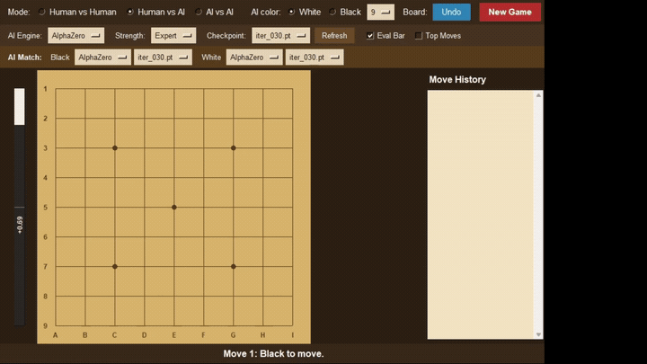

# Gomoku AlphaZero GUI

以 Python、Tkinter 與 PyTorch 製作的桌面五子棋遊戲，提供 9×9、11×11 棋盤，以及使用已訓練 policy-value network 與 PUCT MCTS 的 AI 對手。

此公開版本聚焦於遊戲 GUI、模型推論與必要依賴，不包含訓練程式、評估工具或 PDF 報告。

## 示範影片

[](gomoku.mp4)

上圖為原始錄影轉換的 GIF 預覽。點擊圖片或 [觀看完整 MP4](gomoku.mp4) 可開啟約 16 秒的示範影片；MP4 約 6.31 MiB。

## 功能

- 9×9 與 11×11 棋盤切換。
- 雙人對弈、人機對弈及 AI 自動對弈。
- Random、Heuristic 與 AlphaZero 三種 AI。
- 黑白棋分別選擇 AI 與相容模型。
- 四種 MCTS 搜尋強度。
- 棋譜記錄、悔棋、重新開局。
- 局面評估條與前五個候選落點分析。

規則為任一方向連成五子或以上即獲勝；不實作連珠禁手規則。

## 安裝與啟動

需要 Python 3.10 以上、Tkinter，以及可用的桌面顯示環境。CPU 即可執行；若安裝的 PyTorch 支援 CUDA 且偵測到可用 GPU，程式會自動選用 CUDA。

以下命令從下載或 clone 後的專案根目錄執行。

### Windows PowerShell

```powershell
python -m venv .venv
.\.venv\Scripts\python.exe -m pip install -r requirements.txt
.\.venv\Scripts\python.exe gomoku_game.py
```

直接使用虛擬環境中的 Python，不需要執行 Activate.ps1。

### macOS / Linux

```bash
python3 -m venv .venv
.venv/bin/python -m pip install -r requirements.txt
.venv/bin/python gomoku_game.py
```

若系統的 Python 沒有 Tkinter，需另行安裝該系統提供的 Tk 套件。Tkinter 屬於 Python 系統元件，不透過 requirements.txt 安裝。

requirements.txt 僅列出 numpy 與 torch，目前未鎖定版本；完整 GUI 與模型推論的版本相容性仍需實機確認。

## 對弈操作

1. 在 Board 選擇 9 或 11。
2. 在 Mode 選擇 Human vs Human、Human vs AI 或 AI vs AI。
3. 人機對弈時選擇 AI color、AI 引擎、強度及模型。
4. 點擊棋盤空位落子；使用 New Game 重新開局，Undo 悔棋。
5. 切換棋盤或對弈模式會重新開局。

AlphaZero 模型選單只顯示與棋盤尺寸相符的 checkpoint。若在程式執行期間加入模型，使用 Refresh 重新載入清單。

| 強度 | 每步 MCTS simulations |
| --- | ---: |
| Easy | 10 |
| Normal | 50 |
| Hard | 200 |
| Expert | 400 |

搜尋次數越多通常越耗時，不代表固定棋力等級。AI 計算可能暫時讓介面沒有回應，可先使用 Easy 或 Normal。

Eval Bar 顯示模型對局面的價值估計；Top Moves 以一層後續局面的 value head 評估候選落點。兩者不是經校準的勝率，也不等同完整 MCTS 搜尋結果。

## 隨附模型

| 棋盤 | 檔案 | 模型資訊 |
| --- | --- | --- |
| 9×9 | `checkpoints/iter_030.pt` | 基礎 policy-value CNN；未記錄 residual block 數量，載入時預設為 0 |
| 11×11 | `checkpoints/curriculum_11x11_deep4_continue_iter_007.pt` | policy-value CNN，4 個 residual blocks |

兩個模型共約 5.67 MiB，已納入版本控制，不需要另外下載。詳細資訊、SHA-256 與限制請見 [MODEL_CARD.md](MODEL_CARD.md)。

只載入可信來源的 checkpoint。模型選單會讀取 checkpoints 目錄中的 .pt 檔，請勿將未知來源檔案放入該目錄。

## 執行架構

```text
Tkinter GUI
    |
GomokuEnv + AI agent
    |
    +-- Random / Heuristic
    |
    +-- AlphaZeroAgent
             |
         PUCT MCTS
             |
     PyTorch policy-value network
             |
         checkpoint
```

| 檔案 | 用途 |
| --- | --- |
| `gomoku_game.py` | GUI 與遊戲操作 |
| `gomoku_env.py` | 棋盤、合法落子及勝負判定 |
| `alphazero_agent.py` | 模型與 MCTS 推論封裝 |
| `mcts.py` | PUCT 蒙地卡羅樹搜尋 |
| `policy_value_net.py` | policy-value 網路及 checkpoint 載入 |
| `heuristic_agent.py` | 規則式 AI |
| `device_utils.py` | CPU / CUDA 選擇 |
| `checkpoints/` | 兩個隨附模型 |
| `assets/gomoku-preview.gif` | README 動態預覽 |
| `gomoku.mp4` | 原始示範錄影 |

公開範圍由 .gitignore 白名單限制；本機訓練工具、評估 CSV、PDF、虛擬環境及其他檔案不會被納入。

## 驗證狀態

發布整理時，使用 Python 3.12 進行執行所需七份 Python 檔案的語法檢查，並以不開啟視窗的方式檢查基本棋盤規則及 Heuristic 合法落子。

模型資訊來自靜態 checkpoint metadata 檢查，未執行 pickle 反序列化。驗證環境未安裝 PyTorch，因此尚未驗證模型推論、完整 GUI 對弈與 CUDA 相容性；未啟動訓練。

## 授權

本專案程式碼、隨附模型及示範素材採用 [MIT License](LICENSE)。Python、PyTorch、NumPy 與其他第三方元件依各自授權提供。
